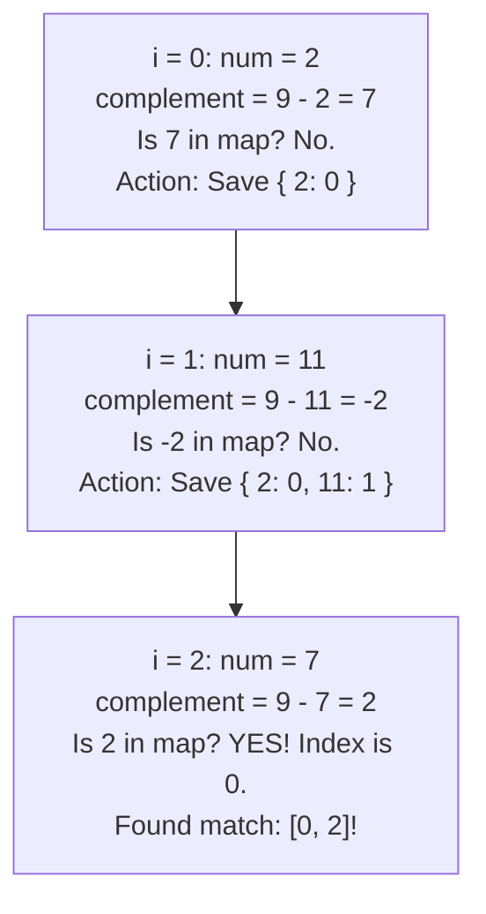

# 1. Two Sum

- **Difficulty:** Easy
- **Topic:** Arrays & Hashing
- **Pattern:** Hash Map / Complement Lookup
- **LeetCode Link:** [1. Two Sum](https://leetcode.com/problems/two-sum/)

---

## 1. Problem Summary

Given an array of integers `nums` and an integer `target`, return **indices of the two numbers** such that they add up to `target`.
- You may assume that each input would have **exactly one solution**.
- You **may not use the same element twice**.
- You can return the answer in any order.

### Example Walkthrough
- Input: `nums = [2, 7, 11, 15]`, `target = 9`
- Look for pair: $2 + 7 = 9$.
- Output: `[0, 1]` (indices of 2 and 7).

---

## 2. Solutions & Complexity Comparison

| Approach | Time Complexity | Space Complexity | Pros / Cons |
| :--- | :--- | :--- | :--- |
| **1. Brute Force (Your Solution)** | $O(n^2)$ | $O(1)$ | Easy to write, no extra memory, but too slow for large $n$. |
| **2. Two-Pass Hash Map** | $O(n)$ | $O(n)$ | Good, but requires two separate iterations. |
| **3. One-Pass Hash Map (Optimal) ★** | **$O(n)$** | **$O(n)$** | **Industry standard.** Finds the pair in a single pass. |

---

## 3. Core DSA Learnings from Your Solution

### 1. You nailed the Brute Force logic!
Your nested loop:
```javascript
for (let i = 0; i < nums.length; i++) {
    for (let j = i + 1; j < nums.length; j++) {
        if (nums[i] + nums[j] === target) return [i, j];
    }
}
```
- Starting `j = i + 1` was very smart: it guarantees you **never pair an element with itself**, and avoids re-checking pairs you already checked.
- Total operations: $\frac{n(n - 1)}{2} \approx \frac{n^2}{2}$, which is $O(n^2)$ quadratic time.
- If $n = 10^5$, $n^2 = 10^{10}$ operations, which triggers **Time Limit Exceeded (TLE)** on large inputs.

---

### 2. The Golden Rule of DSA Optimization
Whenever you have a nested loop:
```
Outer loop: Pick element X
Inner loop: Search for matching element Y
```
Ask yourself: **"Can a Hash Map do this search in $O(1)$ time?"**

Instead of asking: *"Is there another number in the rest of the array that adds up to target?"*  
Rephrase the math equation:
$$\text{num}_1 + \text{num}_2 = \text{target} \implies \mathbf{\text{complement} = \text{target} - \text{num}_1}$$

As you walk through the array, check: *"Have I already seen my complement in my map?"*

---

## 4. The Optimal Solution: One-Pass Hash Map

### Step-by-Step Visualization
Let `nums = [2, 11, 7, 15]`, `target = 9`. We use a `Map` storing `value -> index`.



### Optimal JavaScript Implementation
```javascript
/**
 * @param {number[]} nums
 * @param {number} target
 * @return {number[]}
 */
var twoSum = function(nums, target) {
    const seen = new Map(); // stores number -> index

    for (let i = 0; i < nums.length; i++) {
        const num = nums[i];
        const complement = target - num;

        // Check if complement already exists in our map
        if (seen.has(complement)) {
            return [seen.get(complement), i];
        }

        // Otherwise, remember this number and its index
        seen.set(num, i);
    }
};
```

---

## 5. JavaScript Nuances & Best Practices

### 1. `==` vs `===`
In your code you used:
```javascript
if (nums[i] + nums[j] == target) // ⚠️ Loose equality
```
- In JavaScript, **always use `===` (strict equality)**.
- `==` performs type coercion behind the scenes (e.g., `"" == 0` is `true`, `null == undefined` is `true`), which introduces subtle bugs.

### 2. Why `new Map()` is Better Than Plain Object `{}` Here
In JavaScript, plain objects `{}` convert all keys to **strings**:
```javascript
const obj = {};
obj[2] = 0;
// Keys are converted to string: obj has key "2", not number 2
```
With `new Map()`:
- Keys retain their original types (numbers stay numbers).
- `.has()`, `.get()`, and `.set()` methods are cleaner and faster for frequent insertions and lookups.

---

## 6. Interview Talking Points

1. **Start with Brute Force:** *"The straightforward solution is to use two nested loops to check all pairs in $O(n^2)$ time and $O(1)$ space."*
2. **Explain the Bottleneck:** *"The bottleneck is the inner loop searching for the complement. We can eliminate that search by using a Hash Map."*
3. **Walk through the Optimal Pass:** *"In a single pass, for each number $x$, we check if $(\text{target} - x)$ has already been stored in our map. If so, we return both indices. If not, we store $x$ with its index."*
4. **State Complexities:**
   - **Time:** $O(n)$ — we visit each element at most once, and map lookups are $O(1)$.
   - **Space:** $O(n)$ — up to $n$ elements stored in the map.
